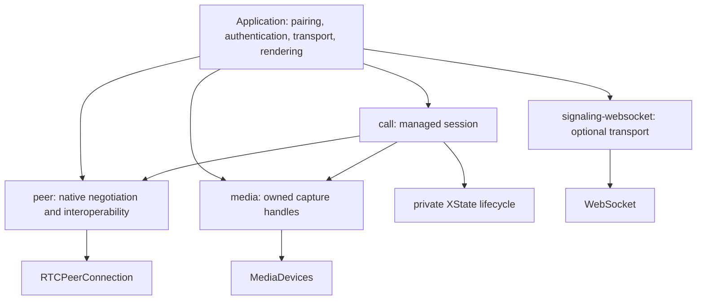

# Architecture

Peerweave is an ESM package family in a pnpm workspace. Each layer has a useful independent
contract; importing a package performs no browser work. Public APIs are functions, immutable
state snapshots, callbacks and native browser objects.

`peer` and `media` have no runtime dependencies and do not import one another. `call` composes
only their package entry points; XState is an implementation detail. The WebSocket adapter is
independent of all three and carries JSON payloads through a documented reference protocol.
`tools/check-repository.mjs` enforces dependency direction and blocks cross-package source imports.
`tools/public-declarations.mjs` traverses the exported declaration graph and rejects actor types.

## Resource ownership

| Layer | Owns | Borrows |
| --- | --- | --- |
| peer | Native connection, negotiation queues, native event handlers | Supplied tracks/streams |
| media | Capture tracks, abort/end listeners | Browser capture platform |
| call | Its peer, capture handles, recovery timers and subscriptions | Rendering and signal transport |
| signaling adapter | Native socket, opening deadline and handlers | Application message callbacks |
| application | Pairing/authentication, renderers and transport integration | Exposed native values |

Closing a peer preserves supplied tracks. Capture disposal stops owned tracks. Calls release
all resources they create on every terminal path. A terminal instance never starts again; new
sessions get new instances and shared session IDs. Native sender/channel handles preserve their
browser behavior and allow interoperability without access to the underlying connection object.

## Source layout

`packages/peer/src/internal` separates a deterministic negotiation controller from a small
native adapter. Ports describe operations we own, and real browser contracts verify that seam.
`packages/media` owns acquisition cancellation and late-result cleanup. `packages/call` keeps its
machine private and applies bounded policy around the public peer/media contracts.
`apps/demo` binds those facades to DOM controls. `apps/signaling-server` is a private two-member
room relay. Tooling, tests, design records and release intents are outside library runtime bundles.

The demo is a Gyral 0.3.6 multi-page app: workbench, independent media preflight, peer-based file
transfer and managed support calls. Pure UI models/views consume serializable controller snapshots.
Driver commands perform actions; subscriptions own controller disposal, and an element hook binds
each native video. Controllers retain streams/files/channels/URLs outside the models. Invitation and
file protocols remain application examples. Framework dependencies do not enter any library.

## API limits

The managed layer supports one camera/microphone and screen video. Use lower layers for system
audio mixing, multiple cameras and specialized track routing. Pairing/invitations, production
membership authorization, room/SFU abstractions and framework bindings remain application or
future package responsibilities. Browser engines are tested through Playwright; actual Safari
hardware and production network behavior require the release checks in [releasing](docs/releasing.md).
