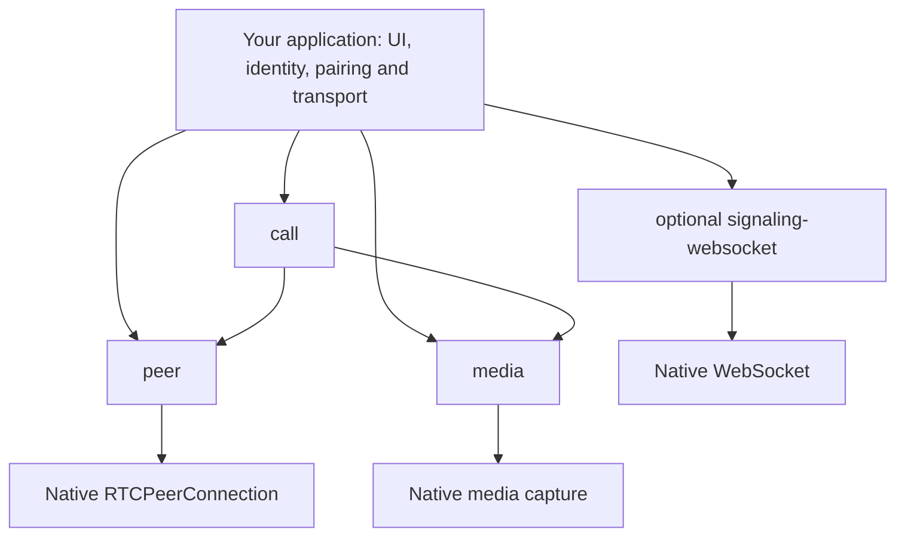

# Peerweave

[](https://github.com/peerweavejs/peerweave/actions/workflows/ci.yml)
[](LICENSE)
[](https://www.typescriptlang.org/)
[](docs/releasing.md)

**Composable browser WebRTC: native peer primitives, owned media capture, and managed one-to-one calls.**
Use the layer you need, keep native browser capabilities, and choose your own UI, signaling
backend and deployment. Peerweave is open source under the MIT license.

[Architecture](ARCHITECTURE.md) · [Examples](apps/demo/README.md) · [Testing](docs/testing.md) ·
[Deployment example](https://github.com/peerweavejs/peerweave-deployment-example) ·
[Contributing](CONTRIBUTING.md)

## Why Peerweave?

WebRTC applications need more than an offer/answer exchange: they must handle negotiation races,
candidate ordering, permission prompts, cancellation, ownership and recovery. Peerweave puts those
mechanisms behind small APIs while leaving rendering, identity, rooms and infrastructure to the app.

- **Compose progressively.** Start with peers or media independently; adopt managed calls when useful.
- **Keep browser capabilities.** Work with native tracks, streams, senders, channels and stats.
- **Make cleanup explicit.** Owned capture is disposed; borrowed tracks remain caller-owned.
- **Test actual behavior.** Deterministic tests are supplemented by native browser, TURN and packed-consumer checks.

## Packages and status

| Package | Responsibility | Runtime dependencies |
| --- | --- | --- |
| [`@peerweave/peer`](packages/peer/README.md) | Perfect negotiation, signal validation, tracks, channels, state and stats | None |
| [`@peerweave/media`](packages/media/README.md) | Camera/microphone/screen capture, cancellation and ownership | None |
| [`@peerweave/call`](packages/call/README.md) | Managed lifecycle, media controls, screen switching and bounded ICE recovery | Peer, media and private orchestration |
| [`@peerweave/signaling-websocket`](packages/signaling-websocket/README.md) | Optional transport for the reference signaling protocol | None |

The packages are implemented previews and **remain private and unpublished on npm**. Package
READMEs describe their APIs; use local packed artifacts until a reviewed release is available.
The [deployment example](https://github.com/peerweavejs/peerweave-deployment-example) demonstrates
consumption of those artifacts without source aliases. Source publication does not establish
npm-scope ownership or complete the [release criteria](docs/releasing.md).

## Quick start

Install Node 24+ and the pnpm version pinned in `package.json`:

```sh
git clone https://github.com/peerweavejs/peerweave.git
cd peerweave
pnpm install --frozen-lockfile
pnpm dev
```

Open `http://127.0.0.1:5173` in two tabs. Join the same room and press **Start call** in each.
Allow camera/microphone access; the preview waits for both participants before negotiation starts.
Use **Mute** for microphone control and **Leave** to release media and signaling. Rejoin for a fresh session.

The framework demo is one small page in plain TypeScript, HTML and CSS. Read its
[DOM bindings](apps/demo/src/main.ts) and [session controller](apps/demo/src/session.ts) to follow
the public APIs. The richer chat, preflight, file-transfer and support pages live in the
[deployment example](https://github.com/peerweavejs/peerweave-deployment-example).
See the [minimal demo guide](apps/demo/README.md).

## Architecture



`peer` and `media` are independent. `call` composes their public exports. Orchestration internals
stay private; imports create no browser resources. Applications own authentication, invitation and
signaling delivery. [Architecture and ownership](ARCHITECTURE.md) explains the full boundaries.

## Configuration and deployment

| Development setting | Default | Purpose |
| --- | --- | --- |
| `PEERWEAVE_PORT` | `8787` | Local reference signaling port |
| `PEERWEAVE_DEMO_PORT` | `5173` | Vite example port |
| `PEERWEAVE_ALLOWED_ORIGINS` | Localhost origins | Optional comma-separated exact page origins for signaling |

Use different ports for separate worktrees. Camera/microphone permissions require localhost or
HTTPS. For tunnel testing, configure both Vite's hostname allowlist and the relay's exact Origin
allowlist using the [tunnel instructions](apps/demo/README.md#testing-through-a-cloudflare-tunnel).
HTTPS pages choose WSS automatically; localhost HTTP pages choose WS.

The local relay is a development reference with in-memory two-person rooms. For server deployment,
authentication, room authorization, short-lived TURN credentials, Docker images, Traefik and Coturn,
use **[peerweave-deployment-example](https://github.com/peerweavejs/peerweave-deployment-example)**.
Media/file bytes travel over WebRTC directly or TURN; a WebSocket proxy carries signaling.
Read the [repository boundary](docs/deploying.md) before adding app infrastructure here.

## Build and test

```sh
pnpm exec playwright install --with-deps chromium firefox webkit
pnpm build           # Build packages and examples
pnpm check           # Complete local framework gate
pnpm test:turn       # Linux/Docker: relay-only UDP/TCP and ICE restart
pnpm test:mutations  # Targeted lifecycle mutation audit
pnpm pack:release    # Reviewable local tarballs; does not publish
pnpm release:status  # Preview Changeset release intents
```

`pnpm check` covers lint, package/docs boundaries, build, strict types, combined unit/native
coverage, three browser engines, example regressions, fresh packed consumers and bundle budgets.
Each library has an 85% floor for all four coverage metrics and a 95% target. Consult the
[quality record](docs/quality.md) for observed results and their limits. Engine tests do not replace
real Safari/mobile devices, permission dialogs or external-network validation.

## Project conventions

- Import other packages through public exports; preserve dependency direction.
- Create browser resources only on explicit invocation and dispose what the current layer owns.
- Validate signal envelopes; let the browser validate SDP and candidate grammar.
- Add behavioral tests before implementation and preserve regression assertions.
- Keep package APIs framework independent and package manifests private until release approval.
- Record design decisions and execution plans; keep [`AGENTS.md`](AGENTS.md) a short navigation map.

See [reliability](docs/reliability.md), [design decisions](docs/design/index.md) and
[releasing](docs/releasing.md) for the detailed contracts.

## Contributing and support

Bug reports, documentation improvements and focused pull requests are welcome. Start with
[CONTRIBUTING.md](CONTRIBUTING.md), follow the [code of conduct](CODE_OF_CONDUCT.md), and use
[GitHub Issues](https://github.com/peerweavejs/peerweave/issues) for reproducible non-sensitive bugs
and proposals. Report vulnerabilities privately using [SECURITY.md](SECURITY.md).

## License

Source code is [MIT licensed](LICENSE). Bundled demo fonts retain their separate OFL notices in
[`apps/demo/src/fonts`](apps/demo/src/fonts); dependency licenses remain with their owners.
